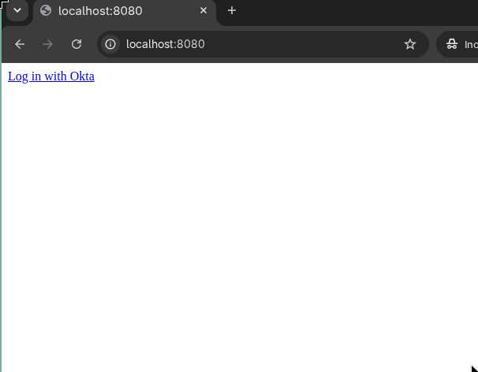
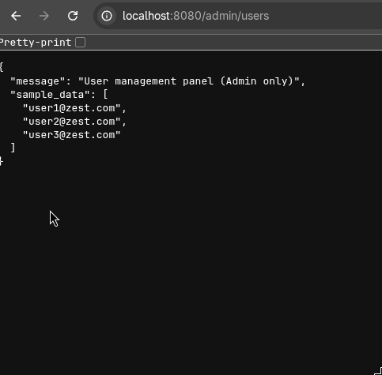
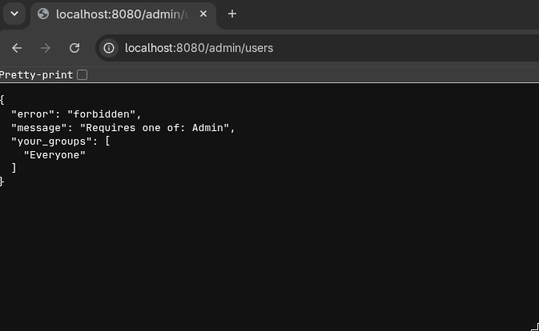
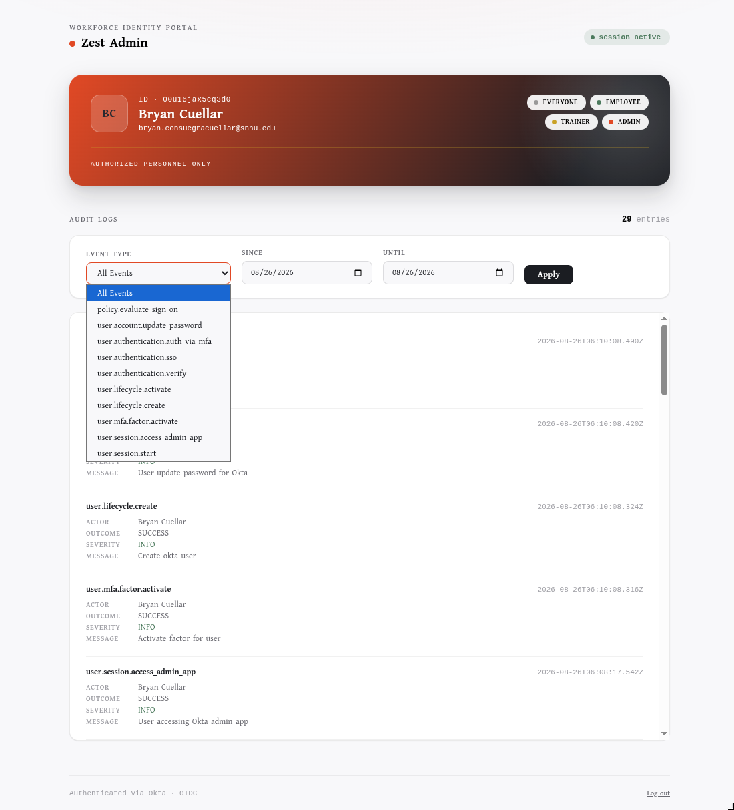
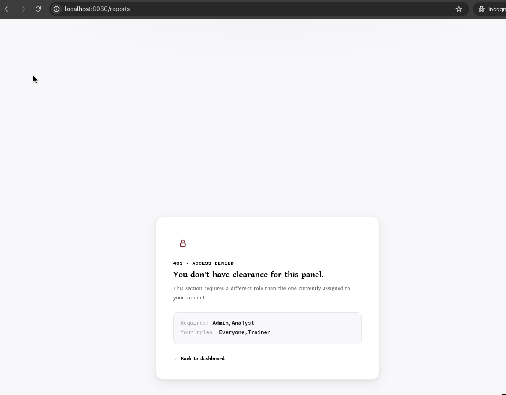

Zest Admin Portal

An internal workforce identity portal for the Zest nutrition app. This project is a web portal for employees only, where authorized personnel can manage, and see users, review filtered reports to find any unusual activity, and access training material. The Demo, allows users to access multiple features with a single sign-on, once inside, each user sees his own name, his status, and what their role is within the company. This project demonstrates enterprise Identity and Access Management (IAM) principles. It includes single sign-on (SSO), role-based access control (RBAC), and layered authentication/access policies. This repository is built to manage the employee side of the consumer app. 

Skills demonstrated

* OIDC and OAuth2 authorization code flow, SSO login via Okta as the identity provider.
* RBAC via group claims
* Separation of Authentication (AuthN) versus Authorization (AuthZ)

Screenshots 
### Okta login
 

### Admin dashboard

### RBAC enforcement - 403 forbidden for unauthorized role
 

Running locally

bash 

git clone git@github.com:bcuellarb23/Zest-iam-admin-portal.git  
cd Zest-iam-admin-portal  
python3 -m venv venv  
source venv/bin/activate       # Windows: venv\Scripts\activate  
pip install -r requirements.txt  
cp .env.example .env           # then fill in your own Okta app credentials  
python3 app.py  

Visit http://localhost:8080 and log in with an Okta account assigned to this app.  

Environment variables .env  

APP EVIRONMENT  

OKTA_CLIENT_ID = Client If from Okta app integration  
OKTA_CLIENT_SECRET = Client secret from Okta app integration  
OKTA_ISSUER = Okta authorization server issuer 
FLASK_SECRET_KEY = ramdom string used to sign Flask session cookies   

TOKEN ENVIRONMENT  

OKTA_SERVICE_CLIENT_ID  
OKTA_DOMAIN  
MANAGEMENT_TOKEN  
OKTA_KEY_ID  

This project uses OAuth 2.0. For its configuration the app uses a client authentication Public key / Private key. The configuration for the public key was a static key over JWKS URI due to the lack of a stable hosting platform. However, for production release this will be changed into a JWKS. The signed JWT is single use and only will last 300 seconds, to achieve this there is an app created in Okta managing API services.  
The application get granted only two scopes: okta.users.read. and okta.logs.read There was also created an Admin role in the application to verify if the identity can actually access this resource. The logs will be displayed in a report section, there are filters that can be applied following Okta's documentation as shown in the image below.

### REPORTS
  

This is an example of an unauthorized user trying to access reports.

### Access denied to reports
 
